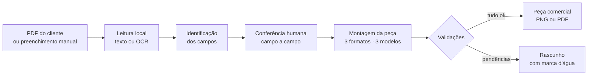

# Gerador de Peças Comerciais

Ferramenta que gera peças comerciais de divulgação de produto (PNG ou PDF) para WhatsApp e e-mail, com os dados digitados ou lidos de um PDF de orçamento, proposta ou apólice.

Funciona como **um único arquivo HTML**, aberto direto no Chrome, **sem internet, servidor, instalação ou banco de dados**. Nada do que é digitado ou importado sai do computador.

> **Sobre este repositório:** a ferramenta foi desenvolvida para uso interno em uma empresa e **o código não é público**. O HTML, os scripts de montagem e de teste, a identidade visual, os textos legais e os dados da empresa não estão aqui.
>
> Este repositório é um **estudo de caso**: documenta como a ferramenta foi pensada, construída e testada.

---

## O que a ferramenta faz

1. **Documento:** importa um PDF (inclusive com senha ou digitalizado) ou começa do zero.
2. **Cliente:** canal, tipo de comunicação e dados do cliente, da contratação e do pagamento.
3. **Produto:** tipo de produto e imagem.
4. **Mensagem:** título, texto de apoio, chamada para ação e contato do consultor.
5. **Visual:** formato, modelo de arte e fundo.
6. **Exportação:** PNG ou PDF, idêntico à pré-visualização.

## Destaques

| Recurso | Como funciona |
|---|---|
| **Leitura de PDF** | Lê o texto com pdf.js e, em página digitalizada, usa OCR (Tesseract) no próprio navegador. Identifica 13 campos: nome, CPF/CNPJ, proposta, apólice, vigência, valor, forma de pagamento, entre outros |
| **Nunca preenche por suposição** | Cada campo sai como *Identificado*, *Revisar* ou *Não identificado*. Valores diferentes no mesmo documento viram opções, sem escolha automática |
| **Conferência humana obrigatória** | Todo campo vindo do PDF precisa ser marcado como "Conferi com o documento". A peça só é liberada depois disso |
| **Contexto do documento** | Dados do corretor, da seguradora, do pagador, do beneficiário ou do estipulante não viram dados do cliente |
| **3 formatos** | 1080 × 1350 (feed), 1080 × 1080 (quadrado) e 1080 × 1920 (stories), cada um com layout próprio |
| **3 modelos de arte** | Padrão, Imagem em destaque e Mensagem em destaque, com prévia ao vivo |
| **Editor de ajustes** | Arrastar, redimensionar e alinhar elementos, com desfazer/refazer. Elementos institucionais ficam travados |
| **Proteções** | Texto que não cabe, sobreposição, texto sobre imagem ou fonte abaixo do mínimo bloqueiam a peça comercial. Nada é cortado ou escondido |
| **Privacidade** | Nada é gravado no navegador (sem localStorage, cookies ou IndexedDB). O nome do arquivo exportado nunca leva dado do cliente |
| **Canal coletivo** | Em grupos, nenhum dado pessoal aparece na arte |

## Números da versão final

| Item | Resultado |
|---|---|
| Versões entregues | 0.1 a 0.15 |
| Verificações automatizadas | 742 aprovadas, 0 reprovadas, em duas fontes diferentes |
| Comparação visual | 936 artes comparadas pixel a pixel com a versão anterior: 936 idênticas |
| Leitura de PDFs de teste | 76 de 76 campos conforme o esperado (antes: 64 de 76) |
| Tamanho do arquivo final | cerca de 7 MB, com leitor de PDF e OCR embutidos |

## Tecnologias

- HTML, CSS e JavaScript puros, sem framework
- Canvas para desenhar a peça (a mesma função gera a prévia, o PNG e o PDF)
- pdf.js para leitura de PDF e Tesseract (WebAssembly) para OCR em português
- PDF montado à mão, com a imagem comprimida por `CompressionStream`
- Python para montar o arquivo único
- Playwright (Chromium) para os testes

## Documentação

| Arquivo | Conteúdo |
|---|---|
| [`arquitetura.md`](arquitetura.md) | Fluxo de dados, módulos, leitura de PDF, desenho e exportação |
| [`testes.md`](testes.md) | Como a ferramenta foi testada e o resultado da versão final |
| [`decisoes-e-evolucao.md`](decisoes-e-evolucao.md) | Princípios do projeto e o que mudou em cada versão |

## Limitações conhecidas

- No formato quadrado, com imagem, muitos dados e três linhas de contato, o conteúdo não cabe e a peça fica bloqueada.
- Layouts de PDF muito diferentes dos testados podem exigir novos rótulos. Nesse caso, o campo fica em "Revisar" ou "Não identificado".
- Leitura por OCR sempre pede revisão.
